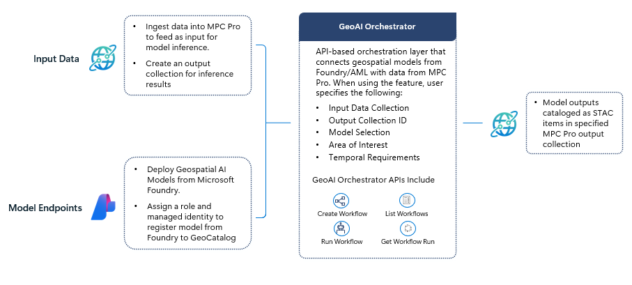

# GeoAI Orchestrator in Microsoft Planetary Computer Pro

GeoAI Orchestrator is an orchestration feature in Microsoft Planetary Computer Pro that enables you to run inference with geospatial AI models from Microsoft Foundry or Azure Machine Learning with data stored in your GeoCatalog.

Instead of manually coordinating data preparation, model execution, and output management through building custom inference pipelines, you can use a repeatable, cloud-based workflow to transform geospatial data into insights and inference results.

GeoAI Orchestrator supports selected geospatial AI models hosted in Microsoft Foundry and Azure Machine Learning.

> [!IMPORTANT]
> GeoAI Orchestrator is currently in invite-only private preview. Contact the Microsoft Planetary Computer team to enable it for your GeoCatalog. Features and capabilities are subject to change.

## Key benefits

GeoAI Orchestrator streamlines GeoAI inference into a single workflow, so you can focus on insights rather than model and data orchestration.

*Figure 1 - Reference architecture.*

Use GeoAI Orchestrator to:

- **Connect data and models** - Connect geospatial data, models, and outputs through simple API calls.
- **Simplify operations** - Operationalize AI models without writing custom orchestration code.
- **Repeat inference at scale** - Run repeatable and scalable inference workloads.
- **Catalog results** - Store outputs in standard formats in GeoCatalog for discovery and downstream analysis.
- **Monitor execution** - Track workflow executions and review run history.

## Supported models

GeoAI Orchestrator supports the following models deployed through Microsoft Foundry:

| Model | Model catalog ID |
| --- | --- |
| [Earth Observation Overhead Sensing Model](https://ai.azure.com/catalog/models/eo-os-object-detection) | `eo-os-object-detection` |
| [MARS Automated Feature Extraction Model](https://ai.azure.com/catalog/models/mars-map-autoregressive) | `mars-map-autoregressive` |
| [Full Motion Video Grounding Detection Model](https://ai.azure.com/catalog/models/fmv-grounding-detection) | `fmv-grounding-detection` |

Review the [input data requirements](./input-data-requirements.md) and the associated model cards in Microsoft Foundry for model-specific performance characteristics, supported ontologies, metrics, and input requirements.

## Pricing

> [!NOTE]
> GeoAI Orchestrator is available at no additional cost during private preview. Underlying Azure resource charges still apply.

You can incur charges for:

- Input and output data storage in Microsoft Planetary Computer Pro. See [Microsoft Planetary Computer Pro pricing](https://azure.microsoft.com/en-us/pricing/details/planetary-computer-pro/).
- GPU resources consumed by deployed AI models for inference.

> [!IMPORTANT]
> Avoid large-scale STAC ingestion while running GeoAI Orchestrator jobs during private preview. Concurrent ingestion and inference workloads can increase CPU utilization and affect workflow performance or execution times.

## Reference Documents

- [Get Started with GeoAI Orchestrator](./get-started-ai-workflow.md)
- [Example of how GeoAI Orchestrator is Used](./use-ai-workflow.md)
- [Input Data Requirements](./input-data-requirements.md)
