# Get started with AI Workflow

Before you run an AI Workflow, deploy a supported model, authorize your GeoCatalog to invoke the model through managed identity, register the endpoint, and create an output collection. This article walks you through that initial setup.

For a feature overview, supported models, and pricing, see [AI Workflow in Microsoft Planetary Computer Pro](./ai-workflow-overview.md).

> [!IMPORTANT]
> AI Workflow is currently in invite-only private preview. Contact the Microsoft Planetary Computer team to enable it for your GeoCatalog. Features and capabilities are subject to change.

## Prerequisites

- Microsoft Planetary Computer Pro deployed in your Azure subscription. See [Deploy a GeoCatalog resource](https://learn.microsoft.com/azure/planetary-computer/deploy-geocatalog-resource).
- AI Workflow feature enabled for your GeoCatalog. Please open an Azure support ticket to get this enabled.
- Supported geospatial data ingested into a GeoCatalog collection. Review the [input data requirements](./input-data-requirements.md) and the selected model's card to confirm that your data meets its requirements.
- Sufficient GPU quota and compute capacity for the selected model deployment.


## Initial setup

### Step 1: Deploy a supported model

1. Sign in to your Azure subscription and open your Microsoft Foundry resource.
1. Go to the model catalog and search for a supported model: `eo-os-object-detection`, `mars-map-autoregressive`, or `fmv-grounding-detection`.

   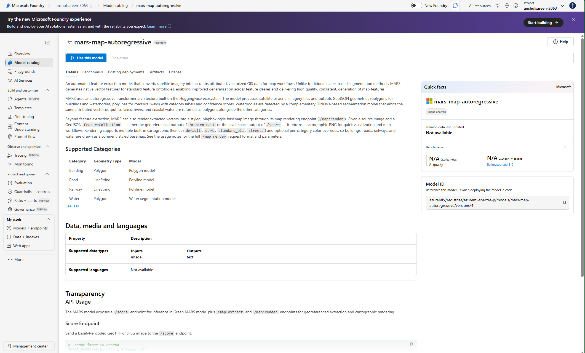

1. Select **Use this model**, and then select a project.

   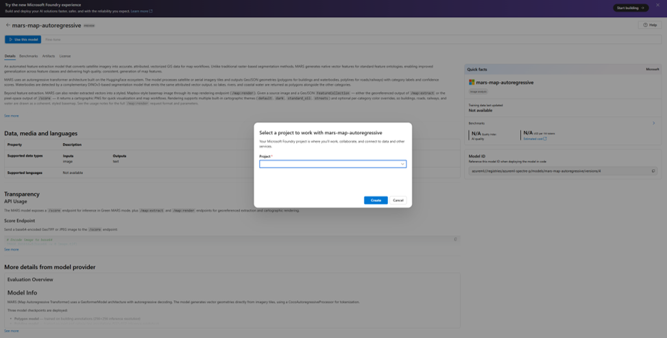

1. Choose the endpoint and deployment names. Select the instance count and virtual machine SKU based on your inference throughput requirements and available compute capacity.

   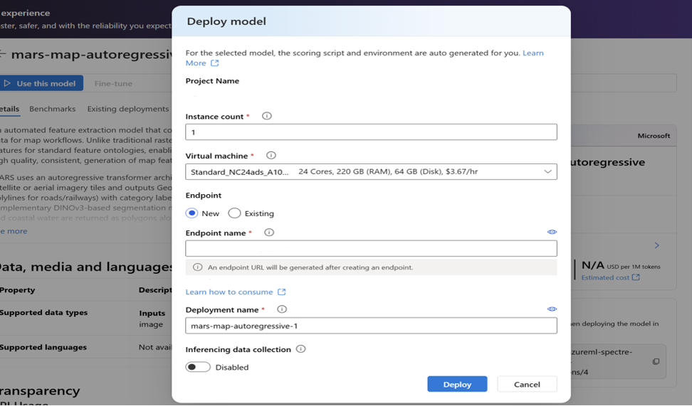

1. Deploy the model. On the resulting Azure Machine Learning endpoint, verify that the authentication type is **Microsoft Entra token-based (Azure AD)**.

   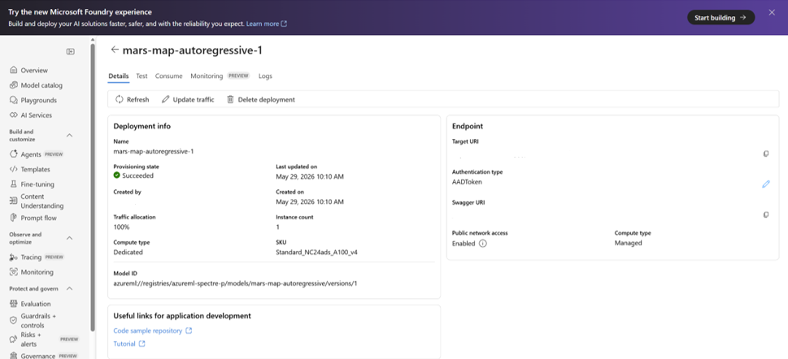

1. Copy the endpoint's **REST endpoint** URL. You use this URL when registering the endpoint and creating a workflow.

### Step 2: Authorize GeoCatalog to invoke the model

Use a user-assigned managed identity so that GeoCatalog can securely access the deployed model.

1. In the Azure portal, search for **Managed Identities**, and select **Create**.
1. Choose your subscription, resource group, and region. Enter a recognizable name, such as `mpc-pro-geoai-inference`, and select **Review + Create** > **Create**.
1. Open the Azure Machine Learning managed online endpoint created during model deployment.
1. Select **Access Control (IAM)** > **Add** > **Add role assignment**.
1. Select the **AzureML Data Scientist** role.
1. Under **Members**, select **Managed identity** > **Select members**.
1. Select **User-assigned managed identity**, select the identity you created, and select **Review + assign**.

   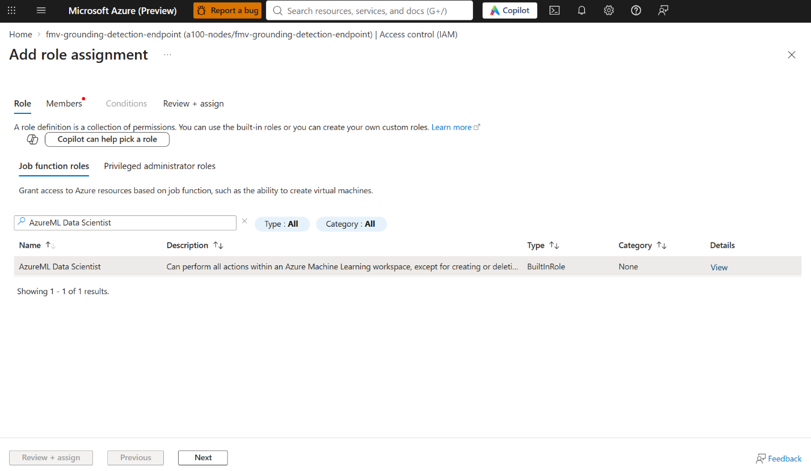

   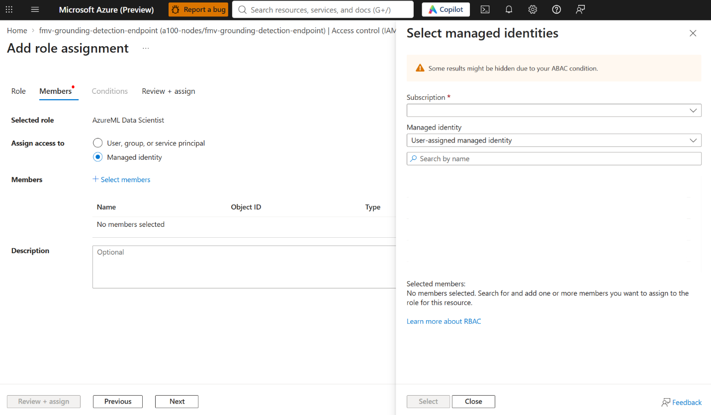

1. Open your GeoCatalog resource. Under **Security**, select **Identity** > **Add**.
1. Select your Azure subscription and the user-assigned managed identity, and then select **Add**.

   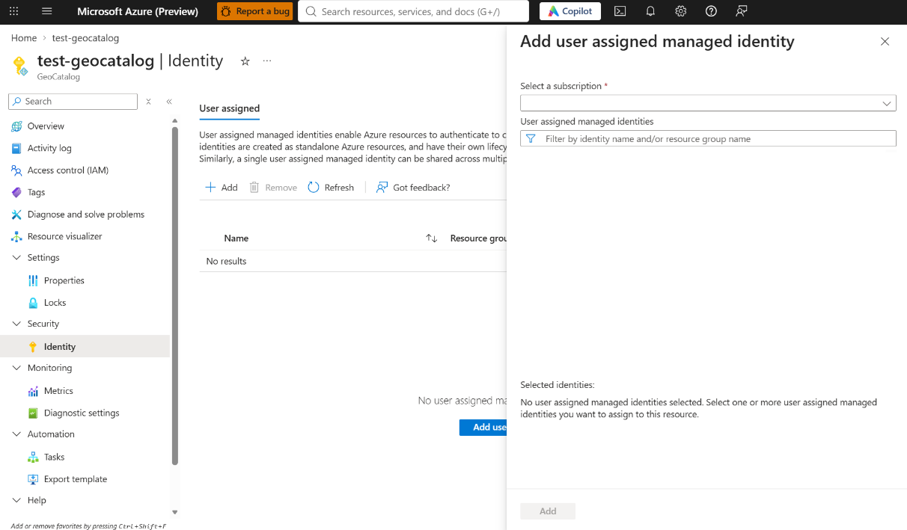

### Step 3: Register the model endpoint

During private preview, register the deployed model endpoint as an ingestion source so that AI Workflow can invoke it with the managed identity.

1. In your GeoCatalog, go to **Settings** and select **Create Ingestion Source**.

   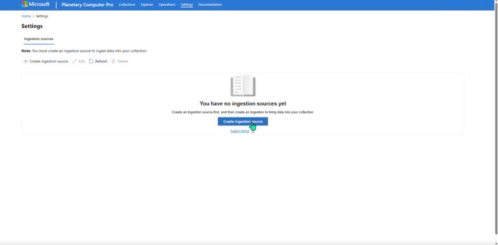

1. For **Credential Type**, select **Managed Identity**.
1. For **Container URL**, enter the model's REST endpoint URL from Step 1.

   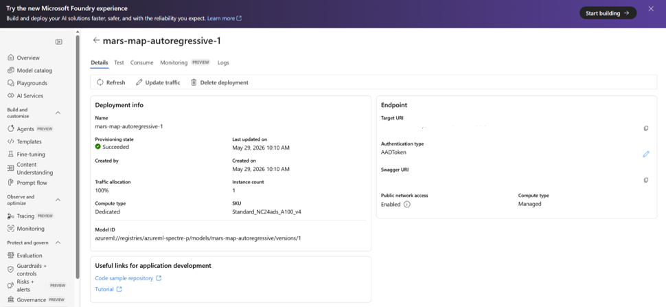

1. For **Managed Identity**, select the identity authorized in Step 2, and create the ingestion source.

   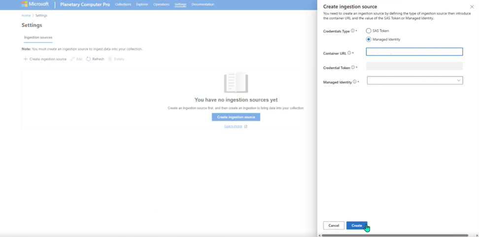

### Step 4: Create an output STAC collection

Create a destination collection for inference results.

1. In your GeoCatalog, select **Collections** > **Create Collection** > **Load a Template Collection**.

   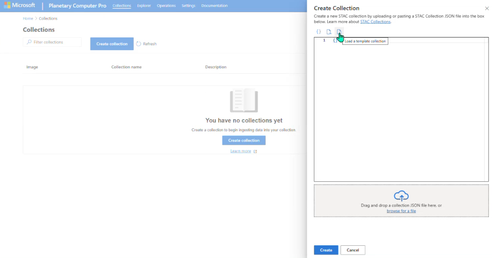

1. Set `id` to a unique collection identifier, such as `eo-os-output-collection`.
1. Set `title` to a descriptive name, such as `EOOS Output Collection`.
1. Add an `item_assets` definition at the same level as `stac_version` in the collection JSON:

   ```json
   "item_assets": {
     "image": {
       "type": "image/tiff; application=geotiff; profile=cloud-optimized",
       "roles": ["data"],
       "title": "Satellite Image Object Detections"
     },
     "geojson": {
       "type": "application/geo+json",
       "roles": ["data"],
       "title": "Object Detections Results GeoJSON"
     }
   }
   ```

   This is a property to add to the template, not a complete collection document. Retain the template's other required fields and ensure that asset definitions match your model's outputs.

   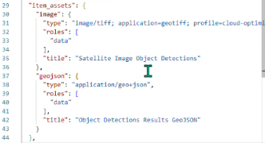

1. Review the configuration and select **Create**.

   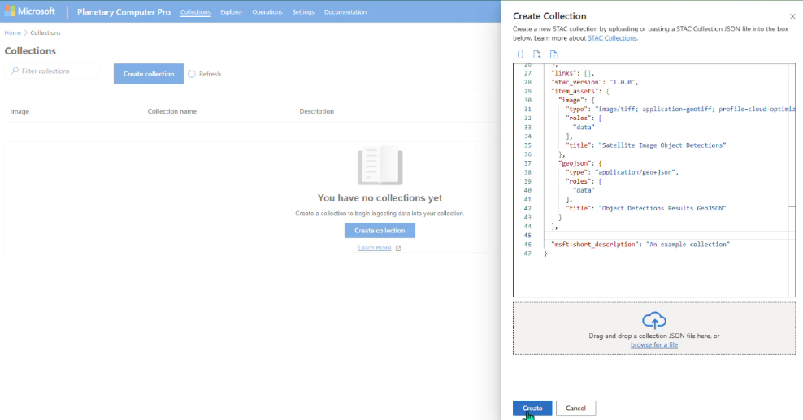

For additional guidance, see [Create STAC collections](https://learn.microsoft.com/en-us/azure/planetary-computer/create-stac-collection?tabs=restapi).

Your GeoCatalog is now ready to use AI Workflow. For the API definitions, see the [API specification](./openapi.json).

## Related content

- [AI Workflow Overview](./ai-workflow-overview.md)
- [Example of How AI Orchestrator is Used](./use-ai-workflow.md)
- [Input Data Requirements](./input-data-requirements.md)
