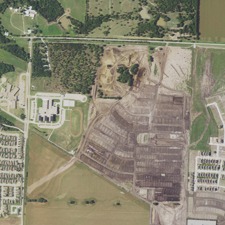
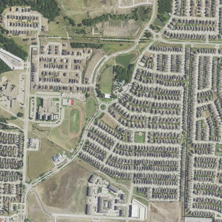
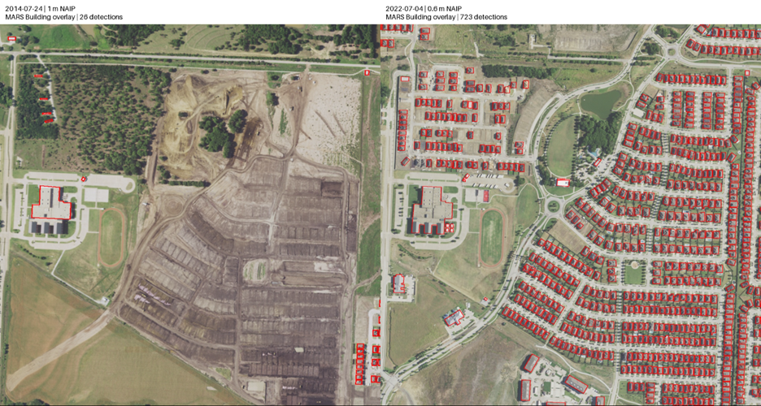
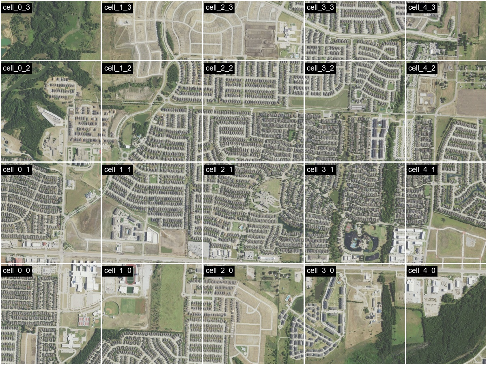
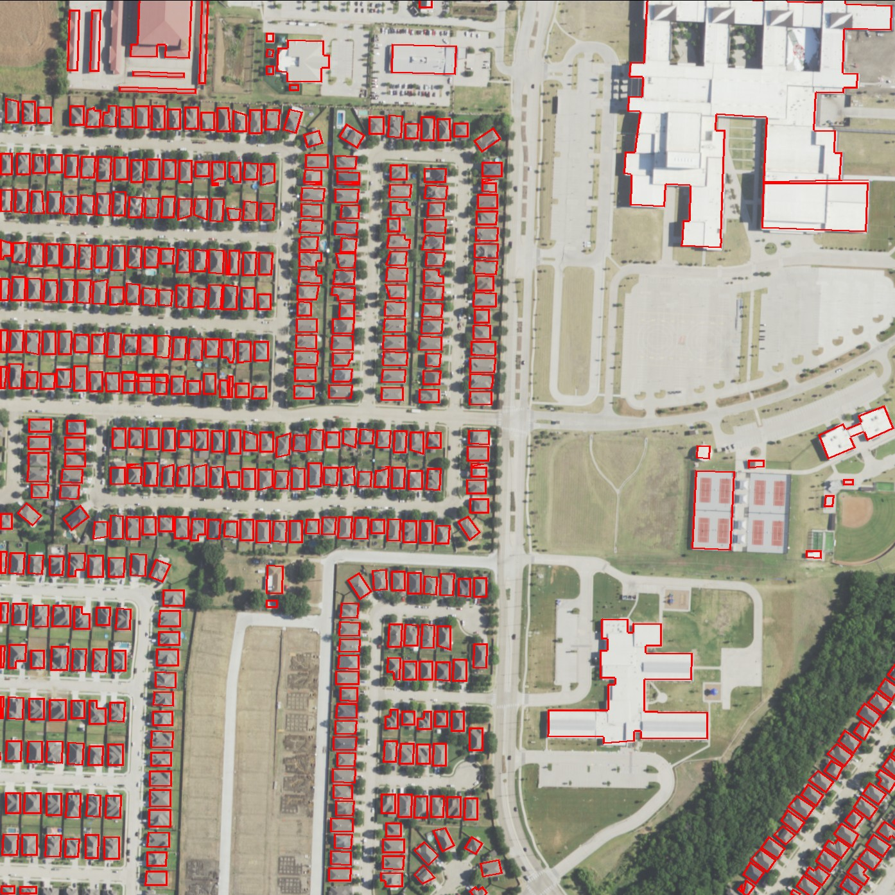
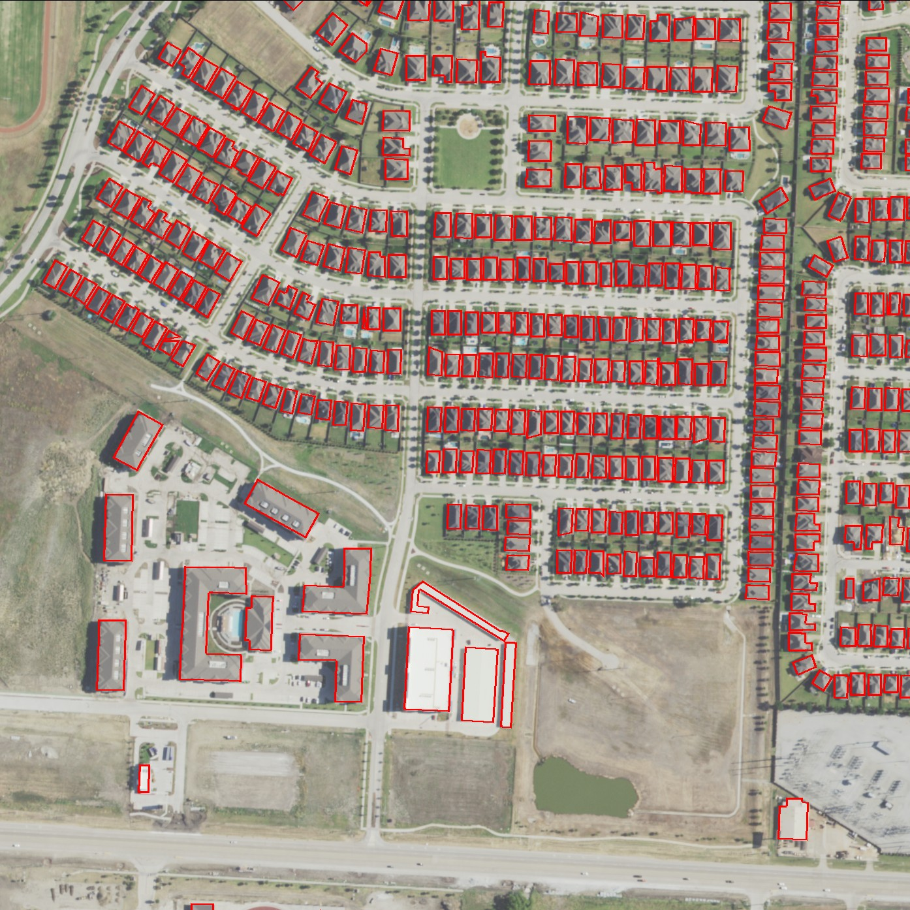
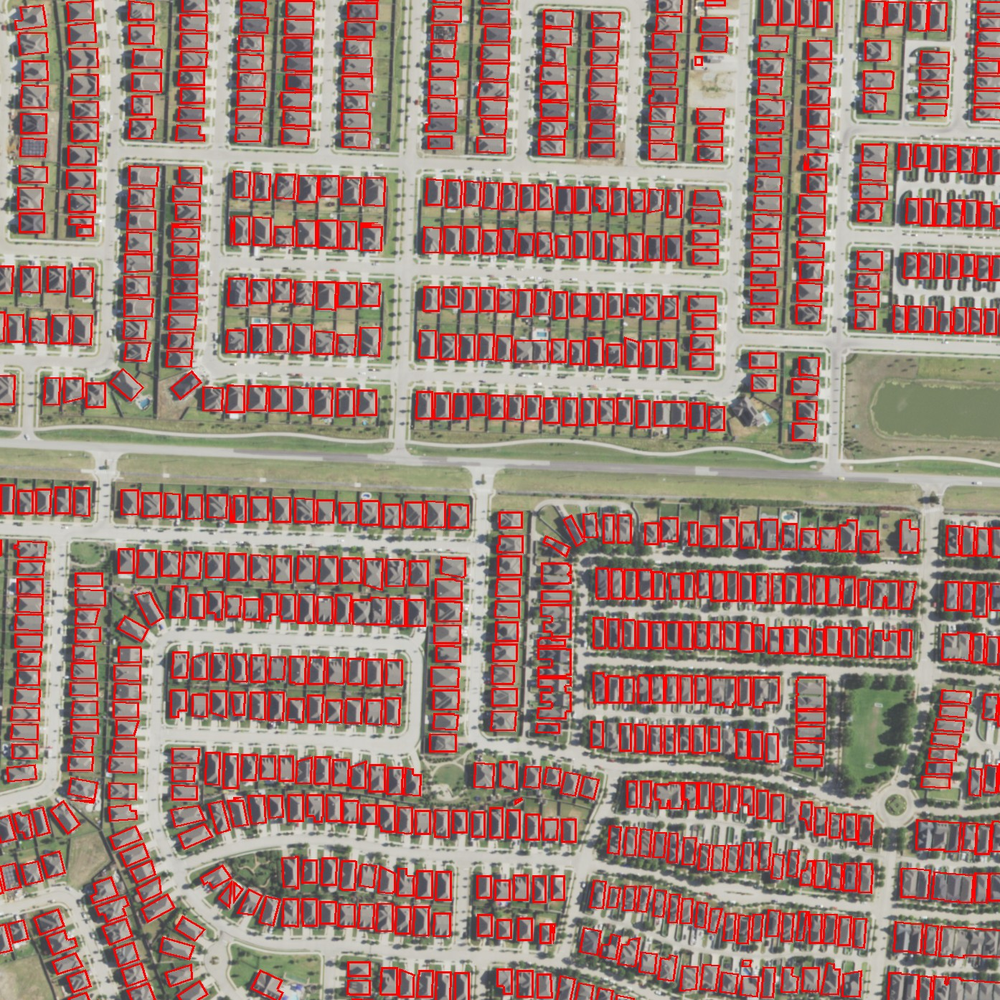
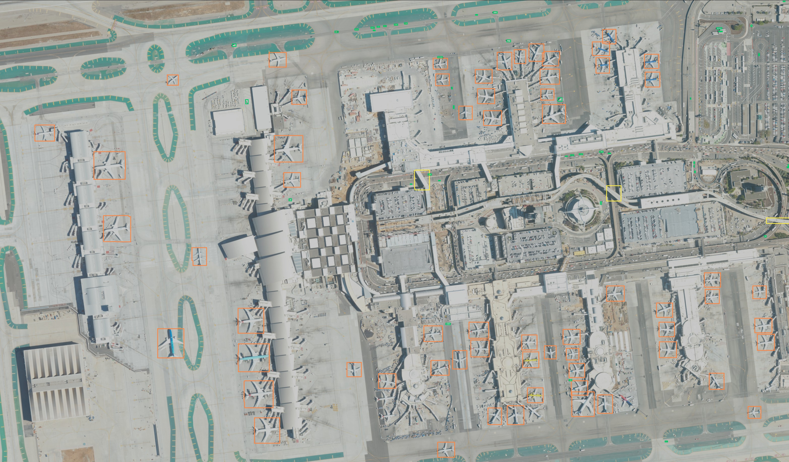

# Example of How to Use AI Workflow

This example walks through how AI Workflow is used to extract building footprints from NAIP imagery of Union Park, Little Elm, Texas, for two periods: 2012-2014 and 2020-2022. Run the MARS Automated Feature Extraction model separately for each period over the same area, and then compare the results.

The input collection contains Union Park imagery acquired between 2012 and 2022. Each workflow filters that collection by acquisition date and selects the most recent matching item. For the input data in this example, the selected images are from July 2014 and July 2022.

> [!IMPORTANT]
> AI Workflow is currently in invite-only private preview. Complete [Get started with AI Workflow](./get-started-ai-workflow.md) before following this example. Features and capabilities are subject to change.

## Example settings

| Setting                    | Value                                                                    |
| -------------------------- | ------------------------------------------------------------------------ |
| Location                   | Union Park, Little Elm, Texas, USA                                       |
| API version                | `2026-08-01-preview`                                                     |
| Workflow IDs               | `union-park-buildings-2012-2014`; `union-park-buildings-2020-2022`       |
| Input collection           | `union-park-naip`                                                        |
| Output collections         | `union-park-buildings-2012-2014`; `union-park-buildings-2020-2022`       |
| Output size                | `MatchInput`                                                             |
| Model                      | `microsoft/mars-map-autoregressive`                                      |
| Model input                | `image_data`                                                             |
| Requested category         | `Building`                                                               |
| Area of interest (AOI)     | `BoundingBox`; approximately 1.1 km across; identical for both workflows |
| Coordinate system          | WGS 84 longitude and latitude                                            |
| Date-time format           | ISO 8601 UTC                                                             |
| Authentication             | OAuth 2.0 bearer token                                                   |

The example follows this API sequence:

1. Create or replace a workflow.
1. List workflows.
1. Get the saved workflow.
1. Run the workflow.
1. Get the workflow run status.
1. Repeat for the second input range.
1. List workflow runs.
1. View and compare results.
1. Cancel a run, if needed.

## Before you begin

Confirm that:

- AI Workflow is enabled for your GeoCatalog.
- MARS is deployed through Microsoft Foundry.
- The deployed endpoint is registered with GeoCatalog.
- GeoCatalog is authorized to invoke the endpoint through a managed identity.
- You have a GeoCatalog API access token with permissions to create and run workflows. See [Configure application authentication](https://learn.microsoft.com/azure/planetary-computer/application-authentication).
- The input and output collections described in the following sections exist.
- The input imagery is accessible and meets the model's input requirements.
- Python and the `requests` package are available for the API examples.

### Prepare the input collection

Create a STAC collection named `union-park-naip` and ingest NAIP items covering Union Park from 2012 through 2022. For your own scenario, create a collection containing imagery for your location and dates of interest.

This example uses four acquisitions. Imagery for every intervening year isn't required.

| Acquisition       | STAC item ID                             | Resolution |
| ----------------- | ---------------------------------------- | ---------- |
| July 6, 2012      | `tx_m_3309649_ne_14_1_20120706`          | 1 m        |
| July 24, 2014     | `tx_m_3309649_ne_14_1_20140724_20141006` | 1 m        |
| November 11, 2020 | `tx_m_3309649_ne_14_060_20201111`        | 0.6 m      |
| July 4, 2022      | `tx_m_3309649_ne_14_060_20220704`        | 0.6 m      |

MARS uses the red, green, and blue (RGB) bands. Ingest the items and ensure their imagery assets are accessible before running the workflow. The workflow doesn't ingest NAIP data automatically.

|                                       July 24, 2014 - 1 m NAIP                                        |                                           July 4, 2022 - 0.6 m NAIP                                           |
| :---------------------------------------------------------------------------------------------------: | :-----------------------------------------------------------------------------------------------------------: |
|  |  |

_Input NAIP imagery of Union Park in July 2014 and July 2022. The selected area changes from site preparation to a residential neighborhood._

### Prepare the output collections

Create `union-park-buildings-2012-2014` and `union-park-buildings-2020-2022` by using the [output collection configuration](./get-started-ai-workflow.md#step-4-create-an-output-stac-collection). Separate collections make the results easy to locate and compare.

## Configure Workflow

Run the code blocks in order in the same Python session. Set the following environment variables before running the code:

| Variable              | Value                                                                                               |
| --------------------- | --------------------------------------------------------------------------------------------------- |
| `GEOCATALOG_URL`      | Your GeoCatalog endpoint URL, such as `https://<name>.<hash>.<region>.geocatalog.spatio.azure.com`. |
| `MODEL_ENDPOINT`      | The deployed MARS REST endpoint URL registered with GeoCatalog.                                     |
| `SPATIO_ACCESS_TOKEN` | Your GeoCatalog API access token, without the `Bearer ` prefix.                                     |

> [!IMPORTANT]
> Don't store access tokens in source code or commit them to source control.

## Step 1: Create or replace a workflow

```python
import os
import time

import requests


BASE_URL = os.environ["GEOCATALOG_URL"].rstrip("/")
API_VERSION = "2026-08-01-preview"
MODEL_ENDPOINT = os.environ["MODEL_ENDPOINT"]
INPUT_COLLECTION = "union-park-naip"

HEADERS = {
    "Authorization": f"Bearer {os.environ['SPATIO_ACCESS_TOKEN']}",
    "Content-Type": "application/json",
}

SCENARIOS = {
    "2012-2014": {
        "workflow_id": "union-park-buildings-2012-2014",
        "start": "2012-01-01T00:00:00Z",
        "end": "2015-01-01T00:00:00Z",
        "output_collection": "union-park-buildings-2012-2014",
    },
    "2020-2022": {
        "workflow_id": "union-park-buildings-2020-2022",
        "start": "2020-01-01T00:00:00Z",
        "end": "2023-01-01T00:00:00Z",
        "output_collection": "union-park-buildings-2020-2022",
    },
}

AOI = {
    "kind": "BoundingBox",
    "bbox": [
        -96.92999982245009,
        33.2227276385933,
        -96.91796751281566,
        33.23284011460632,
    ],
}


def workflow_body(period):
    scenario = SCENARIOS[period]
    return {
        "displayName": f"Union Park building extraction - {period}",
        "description": "MARS building extraction for residential-development comparison",
        "modelId": "microsoft/mars-map-autoregressive",
        "modelEndpoint": MODEL_ENDPOINT,
        "areaOfInterest": AOI,
        "modelInput": {
            "image_data": {
                "collectionId": INPUT_COLLECTION,
                "filter": {
                    "op": "and",
                    "args": [
                        {
                            "op": ">=",
                            "args": [{"property": "datetime"}, scenario["start"]],
                        },
                        {
                            "op": "<",
                            "args": [{"property": "datetime"}, scenario["end"]],
                        },
                    ],
                },
                "sortBy": [{"field": "datetime", "direction": "desc"}],
                "limit": 1,
            }
        },
        "modelHyperparameters": {"categories": ["Building"]},
        "outputCollectionId": scenario["output_collection"],
        "outputSize": {"kind": "MatchInput"},
    }


PERIOD = "2012-2014"
WORKFLOW_ID = SCENARIOS[PERIOD]["workflow_id"]
WORKFLOW_BODY = workflow_body(PERIOD)
run_ids = {}
```

### How input selection works

- **`collectionId`** selects the collection you ingested.
- **`image_data`** is the model's image-input name, used in this example. Full-motion video (FMV) workflows use `video_data` instead. Image workflows support only one image input; use a separate workflow for another input.
- **`filter`** selects items by supported STAC item properties, such as acquisition date, ground sampling distance (`gsd`), or cloud cover (`eo:cloud_cover`). This example filters by date range.
- **`sortBy`** orders matching items by datetime, newest first.
- **`limit`** sets the maximum number of matching source tiles used to create the input image mosaic.
- **`areaOfInterest`** selects the neighborhood to process. Bounding-box order is `[west, south, east, north]`.
- **`categories`** requests `Building` predictions.
- **`outputCollectionId`** identifies where results are published.
- **`outputSize`** controls how predictions are grouped into output STAC items. `MatchInput` merges predictions into one output covering the AOI. For large AOIs, use `FixedSize` to publish separate grid-cell items, as shown in the [large-AOI example](#run-geoai-orchestrator-for-large-aois).

For the four acquisitions in this example:

| Input range | Matching acquisitions    | Selected acquisition |
| ----------- | ------------------------ | -------------------- |
| 2012-2014   | July 2012; July 2014     | July 24, 2014        |
| 2020-2022   | November 2020; July 2022 | July 4, 2022         |

> [!NOTE]
> `limit` controls the maximum number of source tiles used to create the input
> image mosaic. This example uses `limit: 1` because each selected tile covers
> the entire AOI. If your AOI spans multiple tiles, increase the limit so that
> the selected imagery covers the area you want to process.

Use `PUT /ai/workflows/{workflowId}` to save the workflow for the first input range. This request doesn't start inference.

> [!IMPORTANT]
> If the workflow ID already exists, `PUT` replaces its saved definition. Use a unique ID to avoid replacing another workflow.

```python
r = requests.put(
    f"{BASE_URL}/ai/workflows/{WORKFLOW_ID}",
    params={"api-version": API_VERSION},
    headers=HEADERS,
    json=WORKFLOW_BODY,
    timeout=60,
)
r.raise_for_status()
create_response = r.json()
print(
    create_response["id"],
    create_response["createdAt"],
    create_response["lastModifiedAt"],
)
```

A successful request returns `201 Created` for a new workflow or `200 OK` for a replacement. Confirm that `create_response["id"]` equals `WORKFLOW_ID` and that the response includes `createdAt` and `lastModifiedAt`.

## Step 2: List workflows

Use `GET /ai/workflows` to confirm that the workflow is available. Follow `nextLink` so that workflows on later pages aren't missed.

```python
workflows = []
url = f"{BASE_URL}/ai/workflows"
params = {"api-version": API_VERSION, "top": 20}

while url:
    r = requests.get(url, params=params, headers=HEADERS, timeout=60)
    r.raise_for_status()
    page = r.json()
    workflows.extend(page.get("value", []))
    url = page.get("nextLink")
    params = None

ids = {workflow["id"] for workflow in workflows}
print(WORKFLOW_ID in ids)
```

Each successful request returns `200 OK`. The workflow appears in the complete list with its saved definition, and `WORKFLOW_ID in ids` evaluates to `True`.

## Step 3: Get the workflow

Use `GET /ai/workflows/{workflowId}` to inspect the saved input range, AOI, model settings, and output collection before running inference.

```python
r = requests.get(
    f"{BASE_URL}/ai/workflows/{WORKFLOW_ID}",
    params={"api-version": API_VERSION},
    headers=HEADERS,
    timeout=60,
)
r.raise_for_status()
workflow_definition = r.json()
print(workflow_definition["modelInput"])
print(workflow_definition["areaOfInterest"])
print(workflow_definition["outputCollectionId"])
```

A successful request returns `200 OK` with the persisted workflow definition. Verify that:

- `modelInput` contains the configured datetime filter, descending sort, and item limit.
- `areaOfInterest` and `outputCollectionId` match your requested configuration.

## Step 4: Run the workflow

Use `POST /ai/workflows/{workflowId}:run` to start execution of the saved workflow.

```python
r = requests.post(
    f"{BASE_URL}/ai/workflows/{WORKFLOW_ID}:run",
    params={"api-version": API_VERSION},
    headers=HEADERS,
    timeout=60,
)
r.raise_for_status()
run_response = r.json()
run_id = run_response["id"]
run_ids[PERIOD] = run_id
print(run_id, run_response["status"])
```

A successful request returns `202 Accepted` with run metadata such as `id`, `workflowId`, `status`, `percentComplete`, `createdAt`, and `lastModifiedAt`. The initial status is typically `NotStarted` or `Running`.

`percentComplete` currently reports only `0`, or `100` on success. Intermediate progress reporting is planned for a future release.

Save the returned run ID. Acceptance doesn't mean inference has finished, and calling this API again starts another run.

## Step 5: Get the workflow run status

Use `GET /ai/workflows/{workflowId}/runs/{runId}` to poll until the run reaches `Succeeded`, `Failed`, or `Canceled`.

```python
deadline = time.monotonic() + 1800

while True:
    r = requests.get(
        f"{BASE_URL}/ai/workflows/{WORKFLOW_ID}/runs/{run_id}",
        params={"api-version": API_VERSION},
        headers=HEADERS,
        timeout=60,
    )
    r.raise_for_status()
    run_status = r.json()
    print(run_status["status"], run_status.get("percentComplete"))

    if run_status["status"] == "Succeeded":
        break
    if run_status["status"] in {"Failed", "Canceled"}:
        raise RuntimeError(f"Run did not succeed: {run_status}")
    if time.monotonic() >= deadline:
        raise TimeoutError(f"Stopped waiting for {run_id}; check its status again.")
    time.sleep(10)
```

Each successful status request returns `200 OK`. The sample prints lifecycle state and progress, and explicitly reports failed runs, canceled runs, and polling timeouts. Wait for `Succeeded` before proceeding to comparison.

> [!NOTE]
> This sample waits up to 30 minutes. Reaching the polling timeout doesn't cancel the run.

## Step 6: Repeat for the second input range

Keep the input collection, AOI, endpoint, and model settings unchanged. Switch to the second period:

```python
PERIOD = "2020-2022"
WORKFLOW_ID = SCENARIOS[PERIOD]["workflow_id"]
WORKFLOW_BODY = workflow_body(PERIOD)
```

Repeat steps 1-5 without rerunning the Python setup, which would clear `run_ids`. The second workflow filters the same input collection to 2020-2022 and selects its latest matching acquisition, July 4, 2022.

Retain both run IDs for result retrieval:

```python
print(run_ids)
```

You now have two distinct workflow definitions and runs, one per input range. Each run uses the same geographic area but a different selected acquisition.

## Step 7: List workflow runs

Use `GET /ai/workflows/{workflowId}/runs` to review each workflow's execution history and confirm that the submitted run is present.

```python
for period, scenario in SCENARIOS.items():
    runs = []
    url = f"{BASE_URL}/ai/workflows/{scenario['workflow_id']}/runs"
    params = {"api-version": API_VERSION, "top": 20}

    while url:
        r = requests.get(url, params=params, headers=HEADERS, timeout=60)
        r.raise_for_status()
        page = r.json()
        runs.extend(page.get("value", []))
        url = page.get("nextLink")
        params = None

    print(period, run_ids[period] in {run["id"] for run in runs})
```

Each successful request returns `200 OK`. The sample prints `True` for both periods. Run records include lifecycle state, progress, and timestamps.

## Step 8: View and compare results

Open the configured output collections in GeoCatalog:

| Input range | Output collection                |
| ----------- | -------------------------------- |
| 2012-2014   | `union-park-buildings-2012-2014` |
| 2020-2022   | `union-park-buildings-2020-2022` |

Find each run's output STAC items by using `workflow_id` and `workflow_run_id`. Use the run IDs saved earlier, especially if a workflow has been executed more than once.

Inspect the output imagery and GeoJSON prediction assets over the corresponding source imagery. GeoParquet is available through a configured downstream vector transformation.



_Union Park in July 2014 and July 2022. Site preparation in the earlier image is replaced by residential streets and houses in the later image. Building predictions are shown in red._

### Reference results from the tested experiment

| Input range | Actual imagery acquisition | Patches | Building predictions |
| ----------- | -------------------------- | ------- | -------------------- |
| 2012-2014   | July 24, 2014              | 4       | 26                   |
| 2020-2022   | July 4, 2022               | 9       | 723                  |

Both runs should publish outputs to their configured collections so that you can inspect the same area at two points in time. In the reference experiment:

- Much of the central area is under development in July 2014.
- The same area contains residential streets and houses in July 2022.
- Existing buildings, such as the school, provide a recognizable reference.

## Step 9: Cancel a run (optional)

Use `POST /ai/workflows/{workflowId}/runs/{runId}:cancel` if you need to stop a run. Skip this step for the comparison runs until their results are collected.

The sample retrieves the latest state before deciding whether to cancel:

```python
PERIOD = "2020-2022"
WORKFLOW_ID = SCENARIOS[PERIOD]["workflow_id"]
run_id = run_ids[PERIOD]
run_url = f"{BASE_URL}/ai/workflows/{WORKFLOW_ID}/runs/{run_id}"

r = requests.get(
    run_url,
    params={"api-version": API_VERSION},
    headers=HEADERS,
    timeout=60,
)
r.raise_for_status()
run_status = r.json()

if run_status["status"] in {"NotStarted", "Running"}:
    r = requests.post(
        f"{run_url}:cancel",
        params={"api-version": API_VERSION},
        headers=HEADERS,
        timeout=60,
    )
    r.raise_for_status()

    # Cancellation returns an empty body; fetch the state separately.
    r = requests.get(
        run_url,
        params={"api-version": API_VERSION},
        headers=HEADERS,
        timeout=60,
    )
    r.raise_for_status()
    cancel_response = {"skipped": False, "run": r.json()}
else:
    cancel_response = {
        "skipped": True,
        "reason": f"Run is already terminal: {run_status['status']}",
    }

print(cancel_response)
```

An accepted cancellation returns `200 OK` with an empty response body. For active runs, `cancel_response["run"]` contains the state retrieved by the separate `GET` request. For terminal runs, the sample skips cancellation and sets `cancel_response["skipped"]` to `True`.

Cancellation is asynchronous. The state might initially remain `Running`, or the run might finish before cancellation takes effect.

## Run AI Workflow for Large AOIs

Large AOIs are areas spanning more than 10 square kilometres. For these areas,
use `FixedSize`, for example:
`"outputSize": {"kind": "FixedSize", "width": 1000, "height": 1000}`.
`MatchInput` creates one merged output per AOI. For
very large areas, merging can take a long time or exceed memory limits.

`FixedSize` divides the AOI into grid cells and publishes results incrementally
as cells finish. Each published cell is a separate STAC item with a GeoTIFF
with overlaid detections and a GeoParquet file containing detection metadata.
The item's `total_detections` property reports the detection count. Cells without
detections will not produce an item.

> [!NOTE]
> Width and height are EPSG:3857 projected metres, not pixels or exact ground
> distances. Cells at the AOI boundary are clipped to the AOI.
> Set both dimensions to 1,000 metres or less for efficient
> output size and publishing rate.

### Example: Union Park across 20 grid cells

Create a new workflow for fixed-size output, similar to the earlier Union Park
example. The complete definition below uses MARS, the `Building` category, and
the 2020-2022 input range. First, create the output collection
`mars-example-output` using the
[output collection configuration](./get-started-ai-workflow.md#step-4-create-an-output-stac-collection),
then define the new workflow:

```python
WORKFLOW_ID = "mars-example"
WORKFLOW_BODY = {
    "displayName": "Union Park building extraction - grid output",
    "description": "MARS building extraction with incremental grid-cell output",
    "modelId": "microsoft/mars-map-autoregressive",
    "modelEndpoint": MODEL_ENDPOINT,
    "areaOfInterest": {
        "kind": "BoundingBox",
        "bbox": [
            -96.93555956681887,
            33.21247276632429,
            -96.89244043318112,
            33.23952514202406,
        ],
    },
    "modelInput": {
        "image_data": {
            "collectionId": "union-park-naip",
            "filter": {
                "op": "and",
                "args": [
                    {
                        "op": ">=",
                        "args": [{"property": "datetime"}, "2020-01-01T00:00:00Z"],
                    },
                    {
                        "op": "<",
                        "args": [{"property": "datetime"}, "2023-01-01T00:00:00Z"],
                    },
                ],
            },
            "sortBy": [{"field": "datetime", "direction": "desc"}],
            "limit": 1,
        }
    },
    "modelHyperparameters": {"categories": ["Building"]},
    "outputCollectionId": "mars-example-output",
    "outputSize": {"kind": "FixedSize", "width": 1000, "height": 1000},
}
```

Save `WORKFLOW_BODY` using the `PUT` request in step 1, without rerunning its
setup code. Then follow steps 4-5 to run the workflow and check its status.



_The expanded AOI covers approximately 12.06 square kilometres, divided into
20 output grid cells. Boundary cells are clipped to the AOI._

The July 4, 2022 acquisition covers the entire expanded AOI. Inference patches
and output grid cells are different: predictions from overlapping patches are
merged into each cell, and each published cell becomes a separate STAC item.

The reference run completed successfully with the following results:

| Measure                              | Result                   |
| ------------------------------------ | ------------------------ |
| Run status                           | `Succeeded`              |
| Planned inference patches            | 54                       |
| Output grid cells                    | 20                       |
| Published STAC items                 | 19                       |
| Building detections                  | 6,318                    |
| Execution time, from start to finish | Approximately 14 minutes |

The grid-cell count and published-item count differ because not every cell
necessarily produces an output item. Execution time and prediction counts vary
with the imagery, model deployment, and available capacity.

|                                                  Grid cell `cell_0_0`                                                   |                                               Grid cell `cell_1_1`                                               |                                               Grid cell `cell_2_2`                                               |
| :---------------------------------------------------------------------------------------------------------------------: | :--------------------------------------------------------------------------------------------------------------: | :--------------------------------------------------------------------------------------------------------------: |
|  |  |  |
|                                                 480 Building detections                                                 |                                             443 Building detections                                              |                                             810 Building detections                                              |

_Three example grid cells from the same run. Each column represents a separate
STAC item, with its own imagery overlay and vector assets._

- **Collection ID:** `mars-example-output`

Open the output collection in GeoCatalog Explorer and select a grid-cell item
to inspect its imagery and vector assets. Every grid cell with detections is
published as a separate STAC item in the same collection, just like these three
examples. Cells without detections don't produce an item.
Your run produces new item IDs and can
produce different detection counts.

## Configure Model Hyperparameters

Model hyperparameters control model-specific behavior. Earlier, the MARS
example used `"categories": ["Building"]` to select the requested feature
category. For EO-OS object detection, `threshold` controls the minimum detection
confidence: lowering it includes more predictions, but can also include more
false positives.

Image-detection workflows use a default `chip_size` of **1024 pixels** and
`stride` of **800 pixels**. Stride controls the spacing between overlapping
chips. Keep these defaults as a starting point, and validate any changes against
your imagery and target objects. Smaller chips do not increase the native
resolution of the input imagery.

### Example: Compare EO-OS confidence thresholds at LAX

This example compares thresholds of **0.4** and **0.9** over the same small AOI
at Los Angeles International Airport. Keep the imagery, AOI, model endpoint,
and output settings unchanged so that the threshold is the comparison variable.
`MatchInput` merges each workflow's predictions into one output STAC item.

Before running the example, ingest NAIP imagery covering the AOI between 2020
and 2024 into `input-naip`. Create `eoos-hyperparam` using the
[output collection configuration](./get-started-ai-workflow.md#step-4-create-an-output-stac-collection),
and set `EOOS_MODEL_ENDPOINT` to your registered EO-OS endpoint URL.

```python
THRESHOLD = 0.4
WORKFLOW_ID = "eoos-04-threshold"
WORKFLOW_BODY = {
    "displayName": "EO-OS NAIP threshold comparison",
    "description": "EO-OS object detection over LAX",
    "modelId": "microsoft/eo-os-object-detection",
    "modelEndpoint": os.environ["EOOS_MODEL_ENDPOINT"],
    "areaOfInterest": {
        "kind": "BoundingBox",
        "bbox": [-118.417425, 33.938746, -118.397083, 33.948637],
    },
    "modelInput": {
        "image_data": {
            "collectionId": "input-naip",
            "limit": 20,
            "filter": {
                "op": "and",
                "args": [
                    {
                        "op": ">=",
                        "args": [{"property": "datetime"}, "2020-01-01T00:00:00Z"],
                    },
                    {
                        "op": "<=",
                        "args": [{"property": "datetime"}, "2024-12-31T23:59:59Z"],
                    },
                ],
            },
        }
    },
    "modelHyperparameters": {"threshold": THRESHOLD},
    "outputCollectionId": "eoos-hyperparam",
    "outputSize": {"kind": "MatchInput"},
}
```

Save the definition using the `PUT` request in step 1, then follow steps 4-5 to
run it and check its status. Repeat this block with `THRESHOLD = 0.9` and
`WORKFLOW_ID = "eoos-09-threshold"`, then save and run the second workflow. Retain
both run IDs to distinguish their results in the shared output collection.

Both reference runs succeeded and published one STAC item each:

| Detection class | Threshold 0.4 | Threshold 0.9 |
| --------------- | ------------- | ------------- |
| Airplane        | 63            | 61            |
| Vehicle         | 42            | 7             |
| Overpass        | 3             | 1             |
| **Total**       | **108**       | **69**        |

|                                                                 Threshold 0.4                                                                 |                                                               Threshold 0.9                                                               |
| :-------------------------------------------------------------------------------------------------------------------------------------------: | :---------------------------------------------------------------------------------------------------------------------------------------: |
|  |  |

_Predicted airplanes are orange, vehicles are green, and overpasses are yellow._

Lowering the threshold added two airplane predictions and substantially more
vehicle predictions. Vehicles and overpasses were present at both thresholds,
but fewer passed the higher confidence cutoff.

Detection counts and the classes represented depend on image resolution,
scene content, and confidence threshold. Use the EO-OS default threshold of
**0.5** as a baseline, then adjust it to explore the balance between missed
objects and false positives. More detections do not necessarily mean better
accuracy.

## Troubleshooting

Start with `GET /ai/workflows/{workflowId}/runs/{runId}` for the affected run.
For `Failed` runs, inspect `error.code` and `error.message` before changing the
workflow or retrying it.

| Symptom | What to check and do |
| --- | --- |
| Run stays `Running` for a large AOI | Inference can finish before merging and publishing finish. For large AOIs, use `FixedSize` instead of `MatchInput` to publish separate grid-cell items incrementally. Check the output collection for items with this `workflow_run_id`; `percentComplete: 0` alone doesn't mean the run has stopped progressing. |
| Run is `Failed` with a validation error | Read `error.code` and `error.message` to identify the failed validation, such as an unsupported model, invalid input or hyperparameter, or missing collection. Correct the reported field in the saved workflow or create the missing collection before starting a new run. |
| Run fails during patch processing | `WorkflowExecutionError` can include `NoDataInAOI` (all patches failed) or `PartialDataProcessed` (some patches failed). Check AOI coverage, input filters, tile limit, and asset access. Partial outputs don't establish complete coverage; valid imagery with no detections isn't a no-data failure. |
| Execution takes longer than expected | Check the model endpoint's health, compute capacity, and throttling or timeout responses. AI Workflow inference concurrency adjusts automatically based on endpoint responses and latency. |
| Results aren't in the expected collection | Check `outputCollectionId` in the workflow used for the run, then filter that collection's items by `workflow_run_id`. With `FixedSize`, inspect individual grid-cell items rather than looking for one AOI-wide item. Cells without detections don't produce items. If the run failed, inspect its error rather than assuming publication completed. |
| GeoCatalog API returns `401` or `403` | Confirm that the token is for the GeoCatalog API, hasn't expired, and belongs to an identity with the required access. Refresh an expired token and update `HEADERS`; refreshing a token doesn't fix missing permissions. |
| Workflow can't invoke the model endpoint | `EndpointResolutionError` with `Invalid modelEndpoint: <url>` can indicate an unregistered endpoint: register the exact `modelEndpoint` URL as an ingestion source. For `InvalidModelEndpointAuth`, check Microsoft Entra endpoint authentication and the source's managed identity attachment and endpoint role assignment. |

For example, a missing output collection produces these run details:

```json
{
    "status": "Failed",
    "error": {
        "code": "InvalidOutputCollection",
        "message": "Provided output collection is invalid or not found: 'mars-example-output'"
    }
}
```

Create `mars-example-output`, or correct `outputCollectionId`, before starting
a new run. A retry without fixing the collection won't resolve this error.

For missing or partially processed imagery, the run error code is
`WorkflowExecutionError`. An example message for one failed AOI is:

```text
Workflow failed: 1 of 1 AOIs failed: ['<aoi-id>'] | reasons: ['NoDataInAOI']
```

When some patches succeed and others fail, the reason is `PartialDataProcessed`
instead. These reasons summarize patch failures; check input coverage and asset
access as well as model-endpoint errors. Lowering a detection threshold doesn't
resolve missing source imagery.

If the problem persists, include the workflow ID, run ID, error code and
message, and model endpoint name when contacting support. Don't include access
tokens or signed asset URLs.

## Reference documentation

- [AI Workflow overview](./ai-workflow-overview.md)
- [Get started with AI Workflow](./get-started-ai-workflow.md)
- [AI Workflow API specification](./openapi.json)
- [Microsoft Planetary Computer Pro - Microsoft Azure](https://azure.microsoft.com/en-us/products/planetary-computer-pro)
- [Microsoft Planetary Computer Pro - Microsoft Learn](https://learn.microsoft.com/en-us/azure/planetary-computer/)
